

<a href="https://astrum93.notion.site/4cafb9bffadd41aab36297dd738f9e13">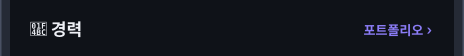</a>

<a href="https://astrum93.notion.site/4cafb9bffadd41aab36297dd738f9e13">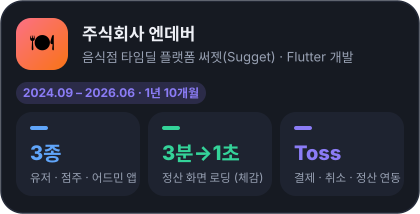</a>

<a href="https://apps.apple.com/kr/app/id6739319710">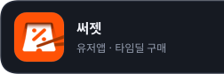</a>

<a href="https://apps.apple.com/kr/app/id6738941397">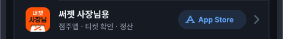</a>

<a href="https://astrum93.notion.site/4cafb9bffadd41aab36297dd738f9e13">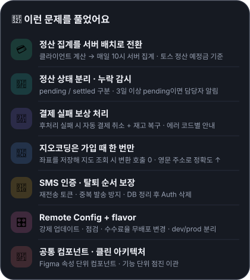</a>

<a href="https://astrum93.notion.site/4cafb9bffadd41aab36297dd738f9e13"></a>

<a href="https://astrum93.notion.site/4cafb9bffadd41aab36297dd738f9e13"></a>

<a href="https://github.com/Astrum93?tab=repositories">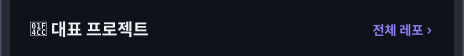</a>

<a href="https://github.com/Astrum93/music_is_life">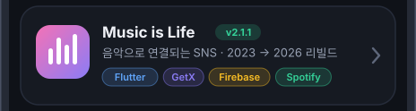</a>

<a href="https://github.com/Astrum93/AirTicket">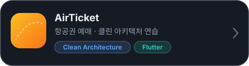</a>

<a href="https://github.com/Astrum93?tab=repositories&q=Todo">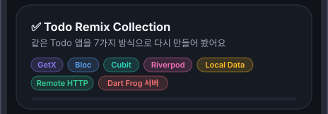</a>

<a href="https://github.com/Astrum93/music_is_life/blob/main/docs/ARCHITECTURE.md"></a>

<a href="https://github.com/Astrum93/music_is_life/tags"></a>

<a href="https://github.com/Astrum93"></a><a href="https://astrum93.notion.site/4cafb9bffadd41aab36297dd738f9e13">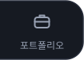</a>

