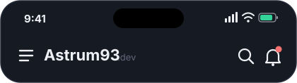
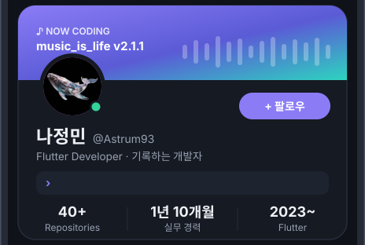
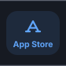
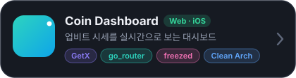
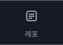
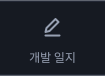

<a href="https://github.com/Astrum93"><picture><source media="(prefers-color-scheme: light)" srcset="assets/light/appbar.svg" /></picture></a>

<a href="https://astrum93.notion.site/4cafb9bffadd41aab36297dd738f9e13"><picture><source media="(prefers-color-scheme: light)" srcset="assets/light/profile.svg" /></picture></a>

<a href="https://astrum93.notion.site/4cafb9bffadd41aab36297dd738f9e13"><picture><source media="(prefers-color-scheme: light)" srcset="assets/light/section-career.svg" /></picture></a>

<a href="https://astrum93.notion.site/4cafb9bffadd41aab36297dd738f9e13"><picture><source media="(prefers-color-scheme: light)" srcset="assets/light/card-career.svg" /></picture></a>

<a href="https://apps.apple.com/kr/app/id6739319710"><picture><source media="(prefers-color-scheme: light)" srcset="assets/light/store-user-info.svg" /></picture></a><a href="https://apps.apple.com/kr/app/id6739319710"><picture><source media="(prefers-color-scheme: light)" srcset="assets/light/store-user-ios.svg" /></picture></a><a href="https://play.google.com/store/apps/details?id=com.sugget.sugget_user"><picture><source media="(prefers-color-scheme: light)" srcset="assets/light/store-user-play.svg" /></picture></a>

<a href="https://apps.apple.com/kr/app/id6738941397"><picture><source media="(prefers-color-scheme: light)" srcset="assets/light/store-partner-info.svg" /></picture></a><a href="https://apps.apple.com/kr/app/id6738941397"><picture><source media="(prefers-color-scheme: light)" srcset="assets/light/store-partner-ios.svg" /></picture></a><a href="https://play.google.com/store/apps/details?id=com.sugget.sugget_partner"><picture><source media="(prefers-color-scheme: light)" srcset="assets/light/store-partner-play.svg" /></picture></a>

<a href="https://astrum93.notion.site/4cafb9bffadd41aab36297dd738f9e13"><picture><source media="(prefers-color-scheme: light)" srcset="assets/light/card-work.svg" /></picture></a>

<a href="https://astrum93.notion.site/4cafb9bffadd41aab36297dd738f9e13"><picture><source media="(prefers-color-scheme: light)" srcset="assets/light/section-cert.svg" /></picture></a>

<a href="https://astrum93.notion.site/4cafb9bffadd41aab36297dd738f9e13"><picture><source media="(prefers-color-scheme: light)" srcset="assets/light/card-cert.svg" /></picture></a>

<a href="https://astrum93.notion.site/4cafb9bffadd41aab36297dd738f9e13"><picture><source media="(prefers-color-scheme: light)" srcset="assets/light/card-award.svg" /></picture></a>

<a href="https://github.com/Astrum93?tab=repositories"><picture><source media="(prefers-color-scheme: light)" srcset="assets/light/section-apps.svg" /></picture></a>

<a href="https://github.com/Astrum93/music_is_life"><picture><source media="(prefers-color-scheme: light)" srcset="assets/light/card-music.svg" /></picture></a>

<a href="https://github.com/Astrum93/coin_dashboard"><picture><source media="(prefers-color-scheme: light)" srcset="assets/light/card-coin.svg" /></picture></a>

<a href="https://github.com/Astrum93/AirTicket"><picture><source media="(prefers-color-scheme: light)" srcset="assets/light/card-airticket.svg" /></picture></a>

<a href="https://github.com/Astrum93?tab=repositories&q=Todo"><picture><source media="(prefers-color-scheme: light)" srcset="assets/light/section-lab.svg" /></picture></a>

<a href="https://github.com/Astrum93?tab=repositories&q=Todo"><picture><source media="(prefers-color-scheme: light)" srcset="assets/light/card-todo.svg" /></picture></a>

<a href="https://github.com/Astrum93/music_is_life/blob/main/docs/ARCHITECTURE.md"><picture><source media="(prefers-color-scheme: light)" srcset="assets/light/card-stack.svg" /></picture></a>

<a href="https://github.com/Astrum93/music_is_life/tags"><picture><source media="(prefers-color-scheme: light)" srcset="assets/light/snackbar.svg" /></picture></a>

<a href="https://github.com/Astrum93"><picture><source media="(prefers-color-scheme: light)" srcset="assets/light/nav-home.svg" /></picture></a><a href="https://github.com/Astrum93?tab=repositories"><picture><source media="(prefers-color-scheme: light)" srcset="assets/light/nav-repos.svg" /></picture></a><a href="https://github.com/Astrum93/music_is_life/blob/main/docs/DEVLOG.md"><picture><source media="(prefers-color-scheme: light)" srcset="assets/light/nav-devlog.svg" /></picture></a><a href="https://astrum93.notion.site/4cafb9bffadd41aab36297dd738f9e13"><picture><source media="(prefers-color-scheme: light)" srcset="assets/light/nav-notion.svg" /></picture></a>

