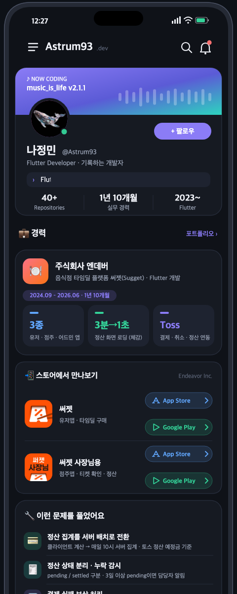
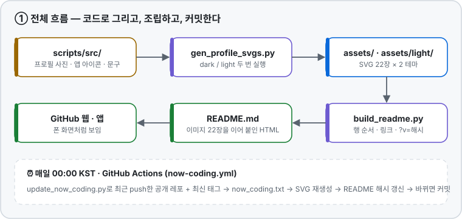
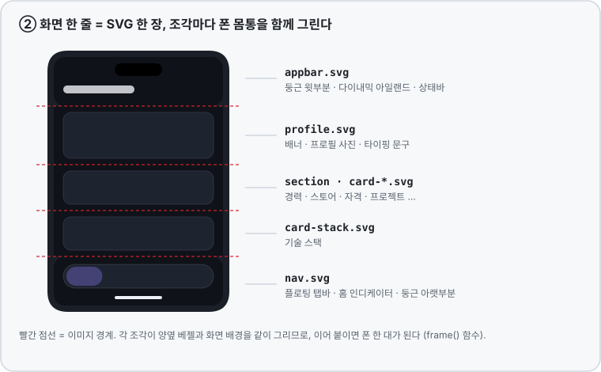
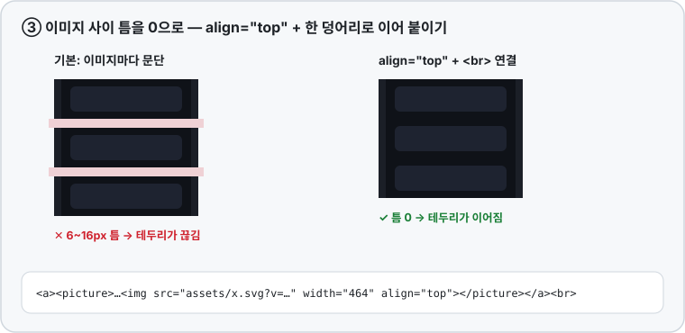
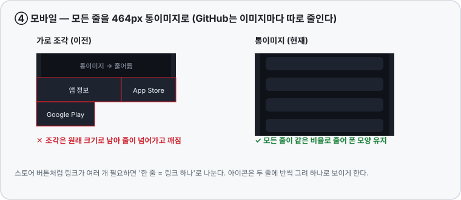
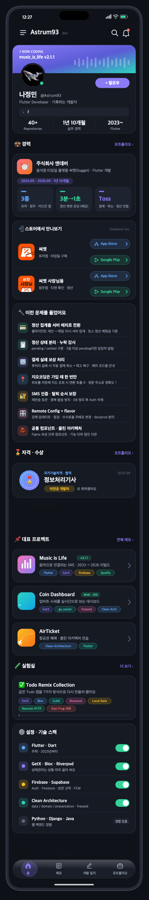
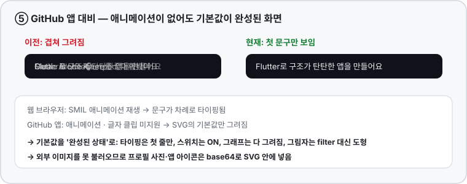
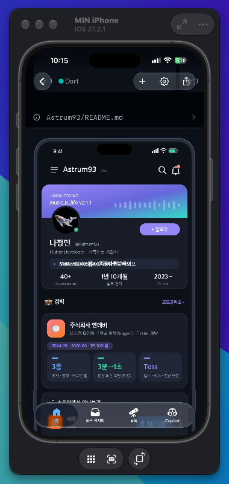
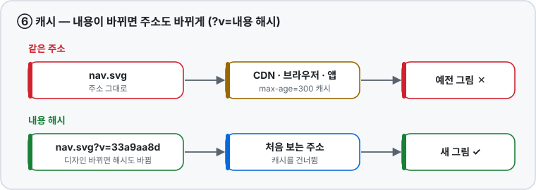

# 프로필 README는 어떻게 만들었나

GitHub 프로필 README를 **폰 화면 한 대**처럼 보이게 만든 방법을 정리한 문서입니다.
GitHub README에서는 CSS와 JavaScript를 쓸 수 없어서, 화면에 보이는 모든 것을 **SVG 이미지로 그리고 빈틈없이 이어 붙였습니다.**

<p align="center">
  
</p>

## 목차

1. [전체 흐름](#1-전체-흐름)
2. [화면 한 줄 = SVG 한 장](#2-화면-한-줄--svg-한-장)
3. [이미지 사이 틈을 0으로](#3-이미지-사이-틈을-0으로)
4. [모바일 대응](#4-모바일-대응)
5. [다크 · 라이트 테마](#5-다크--라이트-테마)
6. [GitHub 앱 대비](#6-github-앱-대비)
7. [캐시 문제 해결](#7-캐시-문제-해결)
8. [NOW CODING 자동 갱신](#8-now-coding-자동-갱신)
9. [직접 고칠 때](#9-직접-고칠-때)

---

## 1. 전체 흐름



```
Astrum93/Astrum93
├── README.md                    ← 이미지 22장을 이어 붙인 HTML (직접 고치지 않음, 스크립트가 생성)
├── assets/*.svg                 ← 다크 모드용 이미지 22장
├── assets/light/*.svg           ← 라이트 모드용 이미지 22장
├── docs/                        ← 이 문서와 그림
├── scripts/
│   ├── gen_profile_svgs.py      ← SVG 생성기 (디자인 · 문구는 전부 여기)
│   ├── build_readme.py          ← README.md 생성 (행 순서 · 링크 · 캐시 해시)
│   ├── update_now_coding.py     ← 최근 작업한 공개 레포 찾기
│   ├── gen_docs_diagrams.py     ← 이 문서의 다이어그램 생성
│   └── src/                     ← 원본 재료 (프로필 사진, 써젯 아이콘, now_coding.txt)
└── .github/workflows/now-coding.yml  ← 매일 자정 자동 갱신
```

흐름은 **생성기로 SVG 그리기 → README 조립 → 커밋**입니다.

## 2. 화면 한 줄 = SVG 한 장



- AppBar, 프로필, 경력 위젯, 스토어 줄, 탭바가 **각각 SVG 한 장**입니다.
- SVG는 코드로 그리는 이미지라 도형, 글자, 그라데이션, 애니메이션을 넣을 수 있습니다. 생성기에 `panel()`(카드 배경), `chip()`(기술 태그), `section()`(섹션 제목) 같은 함수를 만들어 조립했습니다.
- **조각마다 폰 몸통을 함께 그립니다** (`frame()` 함수). 모든 조각이 양옆 베젤과 화면 배경을 같이 그려서, 이어 붙이면 폰 한 대가 됩니다.
  - 맨 위 조각: 둥근 윗부분, 다이내믹 아일랜드, 상태바
  - 맨 아래 조각: 플로팅 탭바, 홈 인디케이터, 둥근 아랫부분
- 색은 팔레트(`DARK`, `LIGHT`) 하나로 관리하고, 같은 코드를 테마 인자만 바꿔 두 번 실행해 두 세트를 만듭니다.

## 3. 이미지 사이 틈을 0으로



- 이미지를 그냥 나열하면 사이에 **6~16px 틈**이 생겨 폰 테두리가 끊겨 보입니다.
- README 전체를 하나의 HTML 블록으로 묶고, 이미지를 `<br>`로 잇고, 이미지마다 **`align="top"`**을 붙였습니다.
- `align="top"`은 GitHub가 지우지 않고 남겨 두는 속성입니다. 이미지를 줄 맨 위에 붙여 **틈이 완전히 0**이 됩니다. 실제 GitHub 렌더러와 GitHub CSS로 측정해 확인했습니다.

## 4. 모바일 대응



- GitHub는 화면이 좁아지면 **이미지마다 따로** `max-width: 100%`로 줄입니다.
- 한 줄을 여러 조각으로 자르면, 화면이 좁을 때 조각들이 원래 크기로 남아 줄이 넘어가고 깨집니다.
- 그래서 **모든 줄을 폭 464px 통이미지로 통일**했습니다. 그러면 폰 전체가 같은 비율로 줄어듭니다.
- 이미지 한 장에는 링크를 하나만 걸 수 있어서, 스토어 버튼은 **"한 줄 = 링크 하나"**로 나눴습니다. 앱 아이콘은 두 줄에 반씩 나눠 그려서 앱별 한 블록처럼 보이게 했습니다.

<p align="center">
  
  <br><sub>모바일 폭(390px)에서도 폰 전체가 같은 비율로 줄어듭니다</sub>
</p>

## 5. 다크 · 라이트 테마

```html
<picture>
  <source media="(prefers-color-scheme: light)" srcset="assets/light/profile.svg?v=…" />
  
</picture>
```

- `<picture>` 태그로 GitHub 테마가 라이트면 `assets/light/`, 다크면 `assets/`를 보여줍니다. GitHub가 공식 지원하는 방식입니다.
- 폰 몸체는 라이트 테마에서 검정, 다크 테마에서는 GitHub 다크 배경과 구분되도록 티타늄 그레이입니다.

## 6. GitHub 앱 대비



<p align="center">
  
  <br><sub>수정 전 GitHub 앱 화면. 프로필 아래 타이핑 문구 4개가 겹쳐 보였습니다</sub>
</p>

- GitHub 모바일 앱은 README 속 SVG를 자체 렌더러로 그립니다. 이 렌더러는 **SVG 애니메이션(SMIL)과 글자 클립을 지원하지 않습니다.**
- 그래서 **애니메이션이 없을 때의 기본 모습이 완성된 화면이 되도록** 설계했습니다. 애니메이션은 웹 브라우저에서만 추가로 재생되는 "보너스"입니다.
  - 타이핑 문구: 기본은 첫 줄만 보이고, 나머지는 `opacity="0"`
  - 스위치: 기본이 ON
  - 시세 그래프: 기본이 다 그려진 상태
  - 탭바 그림자: SVG filter 대신 반투명 도형을 겹쳐 그림
- 이미지로 표시된 SVG는 외부 이미지를 불러오지 못해서, 프로필 사진과 써젯 앱 아이콘은 **base64로 SVG 안에 직접** 넣었습니다.

## 7. 캐시 문제 해결



- 프로필 페이지는 이미지를 항상 같은 주소로 불러오고, GitHub CDN(최대 5분), 브라우저, GitHub 앱이 그 주소의 이미지를 캐시합니다. 그래서 디자인을 바꿔도 한동안 예전 그림이 보였습니다.
- `build_readme.py`가 이미지 주소마다 **파일 내용 해시**를 붙입니다(`nav.svg?v=33a9aa8d`). 디자인이 바뀌면 주소도 바뀌어서, 웹과 앱 모두 새 그림을 바로 받아갑니다.

## 8. NOW CODING 자동 갱신

매일 **한국 시간 00:00**에 GitHub Actions(`.github/workflows/now-coding.yml`)가 실행됩니다.

1. `update_now_coding.py`로 최근 push한 **공개** 레포를 찾고, 최신 버전 태그를 붙여 `scripts/src/now_coding.txt`에 저장합니다.
   - 포크와 프로필 레포 자신은 제외합니다.
   - 비공개 레포는 API에 나오지 않아서 노출되지 않습니다.
2. SVG를 다시 만들고 README의 캐시 해시를 갱신합니다.
3. **바뀐 게 있을 때만** `[auto] NOW CODING: …` 커밋을 남깁니다.

긴 레포 이름은 음파 그림과 겹치지 않게 `…`로 줄입니다. 바로 갱신하려면 Actions 탭의 **Update NOW CODING → Run workflow**를 누르면 됩니다.

> GitHub는 60일 동안 레포 활동이 없으면 예약 워크플로를 멈춥니다. 멈췄다면 Actions 탭에서 다시 켜면 됩니다.

## 9. 직접 고칠 때

| 하고 싶은 일 | 고칠 곳 |
|---|---|
| 문구 · 색 · 디자인 | `scripts/gen_profile_svgs.py` |
| 행 순서 · 링크 · 대체 텍스트 | `scripts/build_readme.py`의 `ROWS` |
| 프로필 사진 교체 | `scripts/src/avatar.png` |
| 이 문서의 다이어그램 | `scripts/gen_docs_diagrams.py` |

고친 뒤 저장소 루트에서 실행하고 커밋합니다.

```bash
python3 scripts/gen_profile_svgs.py assets scripts/src/avatar.png scripts/src dark
python3 scripts/gen_profile_svgs.py assets/light scripts/src/avatar.png scripts/src light
python3 scripts/build_readme.py   # SVG를 다시 만들었으면 꼭 실행 (캐시 해시 갱신)
```

외부 라이브러리 없이 Python 3 표준 라이브러리만 사용합니다.
